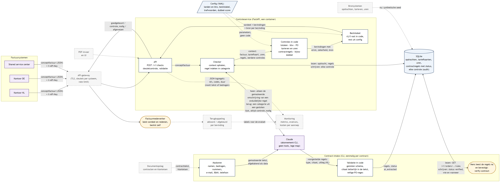
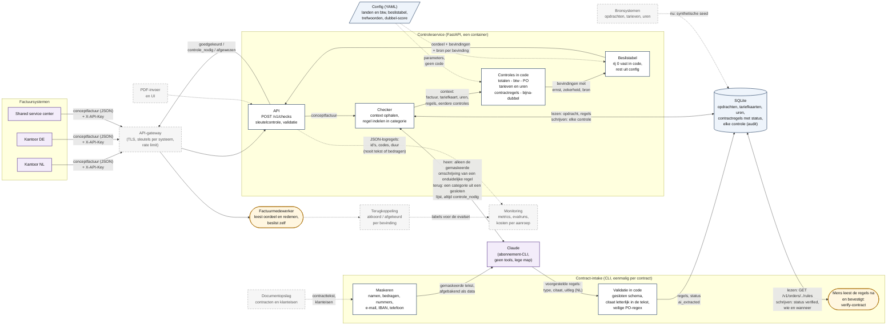

# Architectuur: factuurcontrole

De tekening laat de volledige oplossing zien, met wat er over elke pijl gaat. Wat een doorgetrokken rand heeft, is gebouwd. Wat een stippelrand heeft, hoort bij de volledige oplossing maar zit niet in dit prototype.

## Leeswijzer

| Vorm | Betekenis |
|---|---|
| Doorgetrokken rand | Gebouwd in dit prototype |
| Stippelrand | Hoort bij de volledige oplossing, hier niet gebouwd |
| Geel | Een mens beslist |
| Paars | Buiten de service: de factuursystemen en het taalmodel |
| Blauw | Opslag en configuratie |

## Wat gaat waarheen

- **Naar de service**: de conceptfactuur als JSON. Die blijft op de machine en staat alleen in de tabel `checks`.
- **Naar het model, bij de intake**: de gemaskeerde tekst van een contract of van de factuureisen van een klant. Eenmalig per document.
- **Naar het model, per factuur**: alleen de gemaskeerde omschrijving van een regel die de code niet kan indelen. Een factuur zonder zo'n regel bereikt het model nooit.
- **Nooit naar het model**: bedragen, namen, PO-nummers, factuurnummers, de rest van de factuur.
- **Terug naar het factuursysteem**: het oordeel, en per bevinding een Nederlandse reden en de bron.
- **Het oordeel** komt altijd uit code: de beslistabel. Het model schrijft regels en deelt regels in, het beslist niets.
